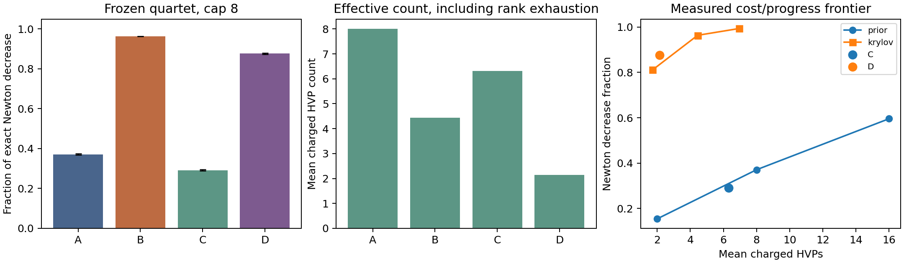

# Held-out Monte Carlo results

The quartet was frozen in commit `6b44ca9` using 24 calibration seeds. The
held-out set has 64 root seeds and 6,144 problem instances. Candidate policies
share full paths for efficient evaluation; counts and times use each exact prefix.

Confidence intervals resample root seeds, preserving within-seed dependence.
They describe the declared balanced synthetic population, not neural networks.

| Cell | Mean Newton decrease fraction (95% CI) | Mean HVPs | Mean fraction/HVP |
|---|---|---|---|
| A | 0.3709 [0.3681, 0.3738] | 8.000 | 0.0464 |
| B | 0.9637 [0.9632, 0.9642] | 4.442 | 0.4495 |
| C | 0.2915 [0.2883, 0.2948] | 6.310 | 0.1163 |
| D | 0.8767 [0.8732, 0.8803] | 2.146 | 0.7081 |

Fixed alignment uses the offline PCA prior; adaptive alignment uses gradient
and residual Krylov expansion. C/D stop at relative residual 0.7 or cap eight.
This loose tolerance was selected for progress per HVP; it is not a guarantee
of a small relative Newton error. More stringent tolerances remain in the raw
candidate results and cost/progress analysis.

A fixed requested count can use fewer HVPs after exact Krylov-space exhaustion.
This is a numerical rank limit, not evidence of an adaptive count policy in B.

| Paired progress effect | Mean | Seed-bootstrap 95% CI |
|---|---|---|
| alignment_B_minus_A | 0.5928 | [0.5898, 0.5957] |
| count_C_minus_A | -0.0794 | [-0.0824, -0.0766] |
| joint_D_minus_A | 0.5058 | [0.5012, 0.5101] |
| interaction_D_minus_B_minus_C_plus_A | -0.0076 | [-0.0111, -0.0039] |

For exact SPD nested subspaces, removing measurements can only reduce one-step
model progress. Any count advantage must therefore be established on cost,
noise avoidance, or repeated updates. A larger D/A progress gap alone cannot
establish a beneficial count/alignment interaction.

The adaptive Krylov update agrees with conventional CG to the independently
checked finite-precision tolerance. Its directional advantage is established
prior art; these observations do not demonstrate a new tomography algorithm.

Family/dimension/gradient results, all 240 candidate/cap summaries, paired
effects, matched-mean-count mixtures, and cost sensitivity are in
[main_summary.json](results/main_summary.json) and
[candidate_summary.json](results/candidate_summary.json).
The main effect intervals are descriptive and are not multiplicity-adjusted
claims of a universal optimizer winner.
